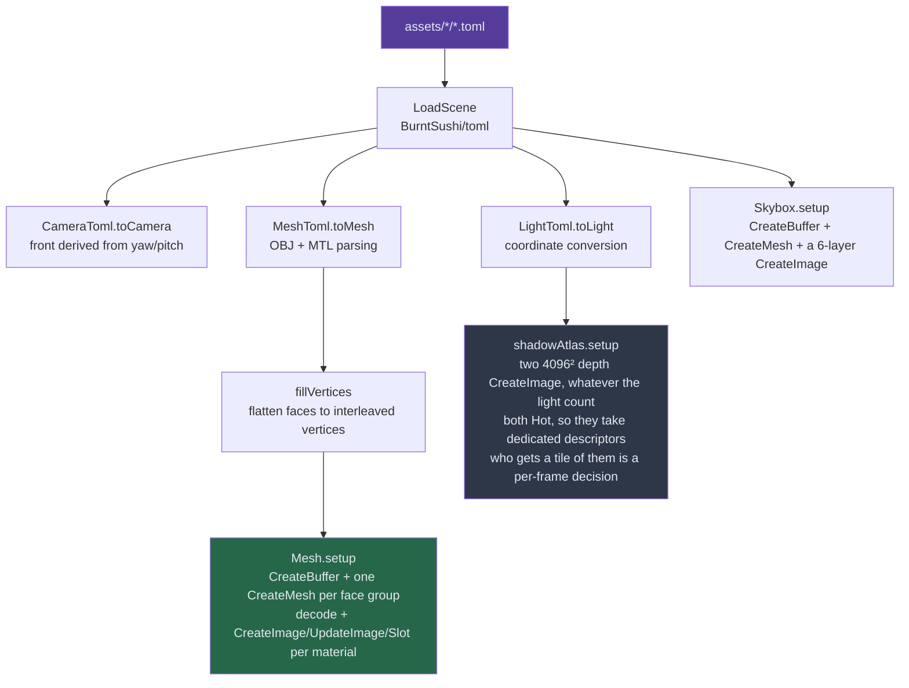
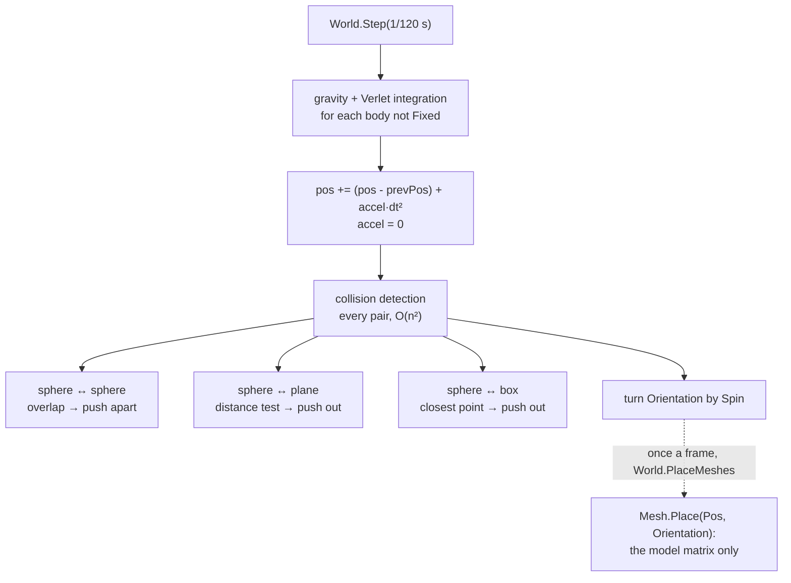

# Features — what the engine does, and why

> **Scope** every implemented feature with where it lives and why it is built that way, the scene format, the config tiers, the roadmap and the performance history. Paths are relative to `src/`.
>
> **Not here** the frame order → `OVERVIEW.md`. The backend contract → `RENDERER.md`. The theory (BRDF, shadow mapping, MSAA in general) → `cheatsheets/PBR.md`, `cheatsheets/GRAPHICS.md`.

---

## 1. Rendering stack

- **Vulkan 1.3 only**, behind `renderer.Backend`/`Frame`/`Pass`/`Compute` (25 methods). The OpenGL 4.1 backend was deleted on 2026-08-05.
- **The modern stack** from howtovulkan.com: dynamic rendering, buffer device address with scalar layout for uniforms, bindless descriptor indexing, synchronization2, VMA, 2 frames in flight.
- **Shaders in Slang** (`shaders/slang/`), compiled to SPIR-V by `build_shaders.sh`.
- **Compute is in the interface** (`Frame.Compute`, storage images through `Slot`, storage buffers by address) but nothing uses it yet.

## 2. Lighting and materials

**Cook-Torrance metallic-roughness PBR** in `pbr.slang`, the style `forward.slang` shades with: GGX distribution, Smith geometry via Schlick-GGX with direct-lighting `k = (r+1)²/8`, Fresnel-Schlick, and a Lambert diffuse weighted `kD = (1 - F)(1 - metallic)`, so metals have no diffuse. `F0 = lerp(0.04, albedo, metallic)`.

What arrives from each light is computed apart from the style, in `lighting.slang`'s `sampleLight`, which returns the direction, the radiance and the shadow:

| Light | Branch in `sampleLight` | Notes |
| --- | --- | --- |
| sun | `LIGHT_SUN` | infinite, along `direction` |
| point | the default | inverse-square falloff `1/(0.01 + d²)`. Import divides Blender's watts by 4π, the W/sr of a source radiating over the whole sphere |
| spot | `LIGHT_SPOT` | point falloff × `smoothstep` between outer and inner cone cosines, watts also over 4π, since a Blender spot is a masked point light. The scene file keeps Blender's `cone` (degrees) and `<coneBlend>` |

- **Up to 64 lights** (`MaxLights` in Go, `MAX_LIGHTS` in Slang, kept in step by hand) in any mix. Each has a `Radius`, the distance where its falloff drops below 1/255 (`scene.lightRadius`); the fragment loop skips a light beyond it before any BRDF or shadow work, which is what makes 64 affordable. A sun has radius 0 and never skips.
- **Materials** come from the MTL: `Kd` (base colour), `Pm` (metallic), `Pr` (roughness), `map_Kd` (albedo texture, linearised with `pow(·, 2.2)`), `map_Bump`/`bump` (normal map). Without `Pm`/`Pr` a material is a matte dielectric (roughness 1).
- **Normal mapping** builds the tangent frame per fragment from screen derivatives (`perturbNormal`, Schüler's cotangent frame), so meshes carry no tangents. Enabled per face group by `UseNormalMap`.
- **Environment.** One equirectangular `.hdr` (`<environment>` in the scene) is the sky drawn behind the scene with `LEQUAL`, uploaded at full size. The lighting maps beside it are baked **at export** by Filament's `cmgen` (`xml_export.py` `write_environment`), into `textures/<name>/`: a specular map prefiltered for GGX with one mip per roughness step (6 levels, 512×256 down) and a cosine-convolved irradiance. `scene/skybox.go` only loads them; `forward.slang` combines them split-sum, with Karis's analytic fit in place of a BRDF LUT. Equirect rather than cubes because cmgen writes it and one 2D slot per map needs no cube support; `envUV` in `common.slang` matches cmgen's mapping only with `--no-mirror`, and cmgen spaces its levels by `r·(2 − r)`, which `forward.slang`'s lookup repeats. Until 2026-10-10 the bake ran in Go at every load, with a `<clamp>` that capped the image first; both went together (`notes/SHOWCASE_PBR.md` §2.5). The light the environment gives (irradiance and specular, never the visible sky) is multiplied by `environmentLightScale` = 0.25 (`scene/skybox.go`): nothing occludes it, so at Blender's full strength it lit the inside of every shadow and hid the scene lights. A tuned stand-in for sky occlusion, to be retired by the HDRI-sun item in `notes/TODO.md` and SSAO.
- **Ambient occlusion** (`core/ao.go`, `shaders/slang/ssao.slang`, `[ambientOcclusion]`). One full-screen pass between the prepass and the main pass, writing an RG16F image of occlusion and view distance. `ssao` rebuilds view-space position from depth through `FrameUniforms.InvProjection`, and the normal from the neighbour on each axis whose depth is closer, so a silhouette does not bend it toward the background. It then tests 16 cosine-weighted samples within `radius`, rotated per pixel by a 4×4 Bayer pattern. `forward.slang` blurs it as it reads, over 4×4 taps, skipping taps at another distance so contact shadows keep their edge: the pattern repeats every 4 pixels, so any 4×4 window holds each rotation once and the noise cancels exactly, which interleaved gradient noise (the first version, until 2026-10-11) did not, leaving a fine hatching. The blur lives in the forward pass rather than a pass of its own because the prepass makes forward shade each pixel once; the distance is stored beside the occlusion because single-sampled, the depth it would otherwise read is the main pass's own attachment. It then raises the result to `intensity` and multiplies **only the environment term**: a scene light has its own shadow map. Depth only, rather than a normal target from the prepass, because the prepass has no colour attachment and would then need one, multisampled and resolved. Under MSAA the prepass resolves sample 0 (`Attachment.Resolve` on a depth attachment, `ResolveModeSampleZero`) into a single-sample `sceneDepth`, since a bindless `Sampler2D` cannot read a multisampled image; single-sampled, AO reads the depth buffer itself. Off in `low.toml`; without the prepass there is nothing to read, and `TexAO` stays 0, the white pixel.
- **Tonemapping.** Radiance is unbounded, so `fsMain` ends with Reinhard plus gamma until an HDR pass exists.

## 3. Shadows

### One atlas per kind, one lookup

**Every shadow is a sub-rect of a 4096² depth texture**, of two of them: `staticAtlas` holds casters that cannot move and is re-baked only when allocation moves; `dynamicAtlas` is a copy of it plus movable casters drawn on top. `ShadowTile.Flags` bit 0 picks which one a light samples.

| Light | Tiles | Baked with | Stored depth |
| --- | --- | --- | --- |
| sun | 1 | `depth.slang`, orthographic | projected depth |
| spot | 1 | `depth.slang`, the cone's frustum widened by 2 texels | projected depth |
| point | 6, one per 90° face | `depth_point.slang` | radial distance / `farPlane`, continuous across faces so one bias fits all six |

One `shadowLookup` in `lighting.slang` serves every type: it projects through the tile's own matrix, maps tile uv into the atlas through `AtlasCoords`, and forks only on the depth encoding.

**Why an atlas.** The pass count stops growing with the light count (one pass per atlas, then a `Pass.Viewport` per tile), tile size is chosen per light, and the static/dynamic cache has one texel currency. It costs two things a cubemap gave free:

- **No cross-face filtering**: each cube face (and spot cone) is widened to `90° + 2 texels` (`cubeFaceFov`) so the kernel at an edge stays in its own tile. Exact on edges, approximate at corners.
- **No border**: a tile's neighbours are other lights' shadows. `shadowLookup` returns lit for anything outside the tile, and `tileSample` clamps every tap one texel inside it. Miss either and one light shows another's shadow.

### Slots and allocation

The atlas is carved once at load into a **fixed slot layout** (`slotLayout` / `buildLayout`, `scene/shadowatlas.go`): by default 1×2048 + 16×512 + 64×256 + 256×128 = 337 slots, 100% of the atlas. Sizes are divisions of `atlasSize`, so **the atlas size buys sharpness and the slot counts buy light budget**: two separate `[shadows]` knobs.

Who holds a slot is decided **per frame** by `shadowAtlas.allocate`:

- **Score** = `radius / distance to camera`, a rough screen footprint. Lights sort by score.
- **Rank picks the slot, the tier caps it.** Each takes the best free slot no larger than its ceiling: 512 above 0.50, 256 above 0.20, 128 above 0.08, nothing below. A sun skips scoring and is capped at 2048.
- **A point light takes six slots at its tier's size**, all or nothing (five faces would leave a lit wedge). Slots are typeless, so the six need not be adjacent.
- **Phase 1b** re-offers spare slots to lights that ended under their ceiling, so a layout tuned for one light mix does not waste sizes on another.
- **Running out costs resolution, never frame time.** A light walks down a pool at a time and finally gets `ShadowIndex = -1`, lit unshadowed.
- **Two hysteresis margins**: `nextTierThreshold` (20%) stops a boundary score changing a light's ceiling every frame; `slotStickiness` (20%) stops two near-equal lights trading a contended pool's last slot every frame. Both are deliberately not config knobs.

**Static vs dynamic.** A mesh is movable when the scene file says `movable = true` or `Mesh.Place` has been called. A light takes a dynamic tile only while a movable caster is in range. The static side is all-or-nothing (a tile with no caster writes nothing, so a partial re-bake would leave a stale tile); the dynamic side is per tile, capped at `settings.ShadowBakeBudget()` texels a frame in score order, a light that misses out keeping its old tile.

### Layout capacity

The atlas is 16 cells of 1024². Cost per light, in cells:

| Light | Cells |
| --- | --- |
| spot @1024 / @512 / @256 / @128 | 1.0 / 0.25 / 0.0625 / 0.015625 |
| point @512 / @256 / @128 per face | 1.5 / 0.375 / 0.09375 |

Capacity after a sun, everything at one tier:

| Tier | Spots | Point lights |
| --- | --- | --- |
| top (score > 0.50) | 48 | 32 |
| mid (> 0.20) | 192 | 128 |
| far (> 0.08) | 768 | 512 |

- **There is no 1024 tier**: four 1024 slots cost a whole quadrant, the one the 128 row uses. An 8192 atlas buys both.
- **The real ceiling is draw calls**: every tile redraws every caster, so 121 tiles × 200 casting meshes would be 24,200 draws. The static/dynamic split is the answer.

### Bias

**Normal-offset**, not depth bias: `shadowLookup` pushes the receiver along its world-space normal before projecting (`NORMAL_OFFSET_2D = 0.08` scaled by the incidence angle, `NORMAL_OFFSET_CUBE = 0.10`), so the remaining depth bias is tiny and contact shadows stay attached. Tuned for the showcase's ~10-unit scale; `FrameUniforms.ShadowNormalScale` (`4096 / atlasSize`) grows it on a smaller atlas.

- **Front-face culling was tried and rejected**: it bakes the far side of a closed mesh, so a sphere floats above a lit disc of its own size. Every tile bakes `CullBack`.
- **`Mesh.CastsShadow`** (`castsShadow = false`, default true) keeps a mesh out of every bake. A single-sided ground plane needs it: with the whole scene above it, it can only shadow itself, and at grazing angles that is acne over the whole surface, which reads as a near-black scene.
- **Still missing**: slope-scaled depth bias (`vkCmdSetDepthBias`, not bound in `go-vulkan`), for a flat surface that must cast.

### PCF

A raw lookup answers lit or shadowed per texel, so edges are blocky. PCF compares the fragment against several neighbouring texels and averages the yes/no answers. It filters the *comparisons*, not the depths, so the atlas sampler is `FilterNearest` and the shader blends.

- `[shadows] pcf` → `settings.Current.Shadows.PCF` → `Flags` bit 1 when cheap, and `PCFStep = 1 / tileSize` (one texel, `texelSize` in the shader).
- **Early bail** (`pcfTile`): 4 corner taps first. If they agree (almost every fragment outside a penumbra) it returns at once; otherwise the full 3×3. `"cheap"` stops at the 4 corners, so a penumbra quantises to quarters.

### Test scenes and reading the atlas

- **`assets/showcase/showcase.toml`** (default) is the beauty shot: 9 lights all near the camera, so every one lands in the top tier. It never exercises variable resolution.
- **`assets/stress.toml`** (`-scene stress.toml`, not in the tree at the moment) is the allocator's: 64 lights, intensities solved backwards from the tier each should land in. Measured: all 64 shadowed, 11 degraded a step, 259 tiles filling 91.8% of the atlas. `MaxLights`, not the atlas, stops it reaching 100%.
- **The atlas is read in RenderDoc.** The three encodings need different contrast ranges (a range that shows the sun renders every spot tile white), and a wrong tile rect still looks plausible, so check tile positions against `AtlasCoords`.
- **Lighting so a shadow is visible**: a light must be high and off to one side; a spot beats a point light (zero contribution outside its cone); with several lights per fragment Reinhard compresses hard, so shadows read by hue, hence near-primary spot colours.

## 4. Depth prepass

Always on; `[debug] noPrepass` turns it off for comparison. A depth-only pass draws every mesh through `prepass.slang` (no colour attachment, empty fragment stage); the main pass keeps that depth and the forward pipeline compares `EQUAL`, so `fsMain` runs once per pixel.

- **Why**: `fsMain` is the most expensive shader (up to 64 lights, each with Cook-Torrance and 4–13 PCF taps). Early-Z already rejects hidden fragments, but only against what has been drawn; the prepass gives exact per-pixel rejection with no sorting. It wins on depth complexity and shows no gain on the flat showcase, which is expected.
- **`EQUAL` compares bits.** `prepass.slang` and `surface.slang`'s `vsMain` both call `worldPosition` then `clipPosition` from `common.slang`, so the operations are the same by construction (not `depth.slang`'s premultiplied matrix, which rounds differently); before 2026-10-11 the prepass repeated them by hand, and both passes read the same uploaded `FrameUniforms` address. Verified: prepass on and off differ in 6 pixels of 2.07 M.
- **Transparency must stay out of it**: blending needs several fragments per pixel. When it lands it is a third pass, sorted back to front, `CompareLess`, depth write off. Alpha cutout belongs in the prepass, but `prepass.slang` must then `discard` identically.

## 5. Anti-aliasing — MSAA

`[antialiasing] mode` (`none` / `msaa`) and `samples` (2/4/8), clamped to what the device supports, so 8× steps down to 4× rather than failing.

**How it works.** Each pixel stores N samples (colour and depth) at fixed points *inside* the pixel, not neighbours. Coverage and depth are tested per sample, but the fragment shader runs **once per pixel per triangle** and its colour fills the samples that triangle covers. Inside a surface all N match and compress; on an edge they split between triangles, and the resolve averages them. Supersampling would instead run the full shader N times everywhere.

- The flow from config to resolve: `core/app.go` requests the count → `pickSampleCount` clamps it → `Capacities().BackbufferSamples` → `core/targets.go` builds the MSAA colour and depth images → screen pipelines take the same count → the main pass resolves into the swapchain image (`RENDERER.md` §3).
- **Limit**: only geometric edges are smoothed; specular shimmer and normal-map aliasing are not. That is what a post-process AA (FXAA/TAA) would add.
- **Cost** on an Intel UHD 620 at 1080p: ~49 FPS off, ~44 at 4×, ~28 at 8×.

## 6. UI overlay

Widget trees from [Gutter](https://github.com/Zephyr75/gutter) are rasterised on the CPU into an RGBA image, uploaded with `UpdateImage`, and drawn as a fullscreen quad over the scene (`core/ui.go`). It redraws only when the tree or hover state changed. An upload inside a pass is staged and copied at the next frame's start: one frame of latency, no stall. `main.go` passes a nil widget today, so only the crosshair draws.

## 7. Scene, assets and physics

### Loading

`scene.NewScene(path, backend)` parses, then uploads:



- **One vertex buffer, several meshes**: an OBJ with three materials is one buffer plus three index lists.
- **Texture paths are portable**: `texturePath` keeps only the basename of Blender's absolute path and resolves it under `textures/` beside the scene file.
- **Textures are mipmapped** on the CPU at load (`mipChain`, a 2×2 box filter) and uploaded a level at a time through `ImageData.Mip`. Roughness comes from `map_Pr` (or `map_Ns`, where Blender puts it without the PBR extension) and metallic from `map_Pm`; each map's red channel multiplies its scalar (`Pr`, `Pm`), which the loader forces to 1 when a map exists, since Blender writes `Pm 0` or nothing once a texture drives the socket.

### Format

Scenes are TOML in a folder under `assets/`, referencing OBJ/MTL in `meshes/` and images in `textures/` beside the scene file, written by the Blender add-on `xml_export.py` (**File → Export → Overdrive (.toml)**). Vectors are arrays, angles are degrees, and the exporter rounds to 6 decimals (4 for angles), past float32's precision. An unknown key rejects the file, as in the settings loader, rather than being dropped in silence. The camera's direction comes from `front`; `yaw`/`pitch` are read only when it is absent.

```toml
[camera]
name = "Camera"
type = "persp"
position = [0.0, -9.5, 3.5]
yaw = 0.0
pitch = 14.0
fov = 45.0

[environment]                 # optional: without it the sky is a flat grey
file = "sky.hdr"              # in textures/, beside the cmgen maps baked from it
strength = 1.0
rotation = 0.0                # degrees about the vertical axis

[[mesh]]
name = "Ground"
position = [0.0, 0.0, 0.0]
rotation = [0.0, 0.0, 0.0]    # degrees; unread, the OBJ being in world space
obj = "DemoGround.obj"
mtl = "DemoGround.mtl"        # optional: defaults to the .obj basename
# Optional, default true. False keeps the mesh out of the shadow bake, which a
# single-sided ground plane wants: with the whole scene above it, it can only
# occlude itself
castsShadow = false

[[light]]
name = "Sun"
type = "sun"                  # sun, point or spot
position = [10.0, 10.0, 10.0]
direction = [-1.0, -1.0, -1.0]
color = [1.0, 1.0, 1.0]
diffuse = 1.0
intensity = 5.0
# A spot adds cone (full angle, degrees) and coneBlend (0..1)
```

Blender and OBJ disagree on the up axis, so import converts positions and (with sign flips) light directions:

```
Blender (x, y, z)  →  Overdrive (x, z, -y)
```

- The camera's `front` is rebuilt from `yaw`/`pitch`, never read; `up` is world up.
- **Static geometry is baked** into the OBJ in world space and drawn with an identity model matrix until something moves it, so `position` matters only for meshes physics moves: it is the point their model matrix turns them about.

### Physics

Plain Go, no graphics calls. A game builds a `physics.World` and adds bodies to it; `World.Step(dt)` runs three phases, collision after integration and meshes placed last, so a mesh is always drawn where its body was resolved to:



```go
world := physics.World{Gravity: mgl32.Vec3{0, -9.8, 0}}
world.Add(physics.NewBoxFromMesh(scene.FindMesh("Plank")))   // always fixed
ball := physics.NewSphereFromMesh(scene.FindMesh("Football")) // movable, its mesh follows it
ball.Restitution, ball.Friction = 0.4, 0.5
world.Add(ball)
app.Run(&scene, HUD, &world, nil)
```

Every shape embeds `Verlet`, which holds what any body has: position and previous position, `Spin`, the `Orientation` it turns, `Fixed`, and the `Mesh` that follows it. The `FromMesh` constructors set the mesh; boxes and planes are always fixed, since only a sphere responds to a contact. A game reads what touched what through `World.Contacts` or `ContactsOf(body)`, every pair once with its normal, one step late since entities update before the step; `World.Remove` takes a body out between steps, and `Velocity`/`SetVelocity` speak metres per second where Verlet stores a distance per step. `ecs` is separate: entities there are game logic, updated once a step before the bodies move, and `App.Run` takes either world or nil.

`core/App.Run` steps it on real time in fixed 1/120 s steps: each frame works out how many steps should have run since physics started and runs the missing ones, at most 8 (a longer stall is skipped, not replayed). One step per frame ran the world three times too fast at 180 Hz. Nothing is stepped for the first `App.StartDelay` seconds (5 by default, `physicsStartDelay`; a game sets 0), counted from the first frame because the startup clock already holds the scene load. Under `-screenshot` it is exactly two steps a frame and the wait is counted in frames, so frame 90 is the same simulated moment on any display, and is still inside the wait.

Verlet stores the previous position instead of a velocity: stable and easy to constrain, no built-in damping.

- **Contacts** (`Sphere.resolve`, called by every collision routine with the normal and the depth). The velocity is taken before the push out and `PrevPos` rebuilt behind the new position, or Verlet would read the push as speed. The speed into the surface is reflected, scaled by `Restitution`; a rebound under 5 mm a step is dropped so a resting ball does not hop. Friction then cancels the contact point's slip, the correction shared between speed and `Spin` by `Inertia` (2/3 for a thin shell like a football, 2/5 solid) and capped by `Friction` times the normal impulse: on a slope this alone gives the rolling acceleration g sin θ / (1 + Inertia). `RollingResistance` finally slows speed and spin in proportion, so the ball stays rolling as it stops.
- **Boxes** (`physics.Box`, `NewBoxFromMesh`) take their axes from the mesh's face normals, not its edges: from a corner of a thin plank a face diagonal is shorter than the long edge. Sphere against box pushes out from the closest point on the box, which covers faces, edges and corners, so a ball rolls off the end of a plank; a centre already inside leaves by the nearest face.
- **Meshes follow** through `Mesh.Place`, position and rotation together, called by `World.PlaceMeshes` once a frame (not once a step: only the last step is drawn) for every movable body with a mesh, and skipped when the mesh is already there. Place only sets the mesh's model matrix, `translate(dest) · rotate · translate(−initialPosition)`, since the OBJ's vertices are in world space; the vertices are uploaded once at load, so a move costs the same for 12 triangles as for 63k. Every pass, the prepass and the shadow bakes included, sends that matrix in `DrawUniforms.Model`; a mesh never moved keeps the identity, so static geometry renders exactly as exported. `Scene.UpdateMeshes` records the moved meshes for the shadow cache, which re-bakes their dynamic tiles.
- **The showcase** (`main.go` `createWorld`): `Floor`, `Plank` and `Wall` are fixed boxes; `Football` is a sphere with `Restitution` 0.4, `Friction` 0.5, `Inertia` 2/3 and `RollingResistance` 0.05. Once physics starts it drops 4 cm onto the plank, rolls down it at 2.5 m/s², and stops on the floor about 1.25 m from the plank 2.8 s later. Suzanne has no collider.

## 8. Configuration and quality tiers

Every runtime knob is in the TOML file; a bad value rejects the file (`settings.Load`, `checkShadowAtlas`) rather than being clamped.

| Section | Keys |
| --- | --- |
| `[window]` | `width`, `height` |
| `[renderer]` | `backend` (only `"vulkan"`) |
| `[shadows]` | `atlasSize`, `slotDivisors`/`slotCounts`, `tierScores`, `dynamicAtlas`, `bakeBudgetMiB`, `pcf`, `nearPlane`/`farPlane` |
| `[antialiasing]` | `mode`, `samples` |
| `[textures]` | `anisotropy` (does almost nothing until textures have mips) |
| `[debug]` | `validation`, `lockCamera` (reproducible captures), `noShadows` (tells "too dark" from "wrongly shadowed"), `noPrepass` (checks the prepass renders like plain depth testing) |

**`configs/low.toml`** is the low tier, with no low-end code path: atlas halved to 2048 (same 337 slots, half the sharpness each), `dynamicAtlas = false` (no per-frame shadow work, movers cast nothing), `pcf = "cheap"`, no MSAA, no anisotropy.

## 9. Roadmap and known gaps

1. **Texture-driven PBR and real IBL.** AO maps (metallic `map_Pm` and roughness `map_Pr` are done, `scene/mesh.go`), and the skybox prefiltered into an irradiance cubemap, a roughness-mip specular cubemap and a BRDF LUT (`cheatsheets/PBR.md` §9).
2. **HDR, tonemapping, bloom.** Render the main pass into an `RGBA16F` image, then a post pass: bright-pass, separable blur, ACES/Reinhard, gamma. Nothing under `vulkan/` has to change, which is the test of the interface.
3. **Ray-traced shadows** through `VK_KHR_ray_query` in `lighting.slang`'s shadow test, then AO, reflections, one-bounce GI (`cheatsheets/RAYTRACING.md` §5). Needs the acceleration-structure bindings in `go-vulkan`.
4. **Clustered forward**: the per-cluster light list that removes the fixed 64-light cap and stops off-screen lights scoring high.

| Known gap | Where |
| --- | --- |
| No cascades: the sun is one 2048 ortho tile over a fixed [-10, 10] box | `Light.shadowTile` |
| A static re-bake redraws every tile, not the changed ones | `Scene.UpdateShadows` |
| The score ignores whether a light is on screen | `lightScore` |
| A moving light does not dirty its own tiles | nothing moves a light yet |
| No mipmaps on any texture | the mip fields and `GenerateMips` come back with their first caller |
| The physical device is `devices[0]`, not scored | `vulkan/backend.go` |
| No automated image regression test | `-screenshot` makes one possible |
| No slope-scaled depth bias | needs `vkCmdSetDepthBias` in `go-vulkan` |

## 10. Performance notes

Every fix below was found by measurement.

- **Shadow taps dominate the fragment shader** (up to 13 per light per fragment). Two fixes closed most of the gap to the old OpenGL backend on an Intel UHD 620:
  - **Dedicated shadow descriptors.** Intel's driver re-fetches a dynamically indexed descriptor on every tap, so the atlases sit in binding 3 indexed by a literal, ~1.7× faster. Near-free on discrete GPUs, but the atlas made it cost nothing to keep.
  - **Early-bail PCF** (§3).
- **Material reads hoisted out of the light loop.** Through a BDA pointer the compiler cannot prove a load is loop-invariant, so reading material fields per light re-fetched them every iteration. `fsMain` copies them into a local `MatParams` once, since 2026-10-11 the `Surface` that `surface.slang`'s `loadSurface` builds.
- **The uniform split** (per frame / per tile / per draw) cut the per-draw payload from 1312 to 100 bytes. No measurable frame-rate change on the iGPU: the win is structural. Splitting `BakeUniforms` out took a full atlas from ~1.6 MiB of arena a frame to ~40 KiB.
- **FPS subtraction does not measure anything here.** Under vsync (FIFO, 180 Hz on this machine) a frame drops cleanly to the next interval, so 9 lights and 64 lights both read ~181 FPS. RenderDoc's per-pass timings are the instrument; the engine's own timestamp queries were deleted unused.
